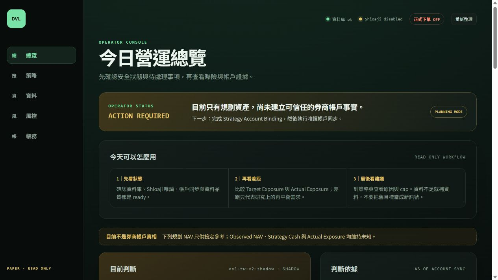
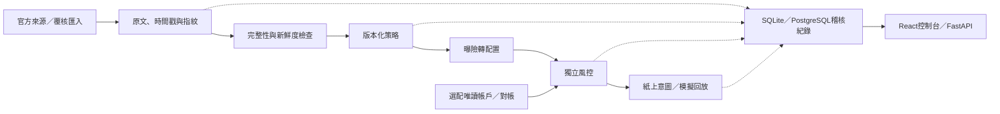

# Dynamic Leverage Control

**An auditable exposure-monitoring, strategy-research, and paper-trading platform for Taiwan ETFs.** Every target position traces back to its source data, strategy version, and risk decision: the system blocks on stale or incomplete inputs, handles stock splits without false loss signals and trading halts without phantom fills, and books fills idempotently (362 automated tests). Live trading is disabled, and no strategy has yet been shown to beat 0050 (Taiwan's benchmark ETF); engineering correctness is verified separately from returns.

台灣ETF曝險監控、策略研究與紙上交易平台。將市場資料、策略決策、風控理由及帳務對帳串成可追溯的紀錄，回答三件事：**數字從哪來、現在為什麼能或不能調整部位、結果能否重建。**

**Python／FastAPI · SQLAlchemy · React／TypeScript · SQLite／PostgreSQL**

專案目前限於Paper（紙上交易模擬）及Shadow（只計算候選決策）研究；正式下單關閉，尚未證明能穩定打贏0050。工程正確性與投資績效分開驗收。

## 先看實際畫面



這是實際前端連接全新SQLite資料庫的畫面：未綁定券商、未載入憑證，也沒有市場擷取或真實持倉。50萬元只是虛構規劃本金，其他帳戶數字保持未知。畫面保留阻擋原因，沒有為展示捏造獲利曲線。[截圖來源與檢查](docs/assets/README.md)

## 值得看哪些工程設計

| 問題 | 實作選擇 | 程式與驗證入口 |
|---|---|---|
| 外部資料缺漏或過期，仍可能產生看似合理的目標 | 每種來源分開驗完整性與新鮮度；缺必要輸入不沿用舊目標，風控獨立限制增加曝險 | [來源新鮮度](src/dynamic_leverage/services/freshness.py)、[風控測試](tests/unit/test_risk.py) |
| 分割造成單價驟降，容易誤算虧損及觸發退出 | 對齊淨值單位與持有權益，另外處理停牌；不把有淨值當成可以成交 | [分割資料驗收](src/dynamic_leverage/services/capital_nav_research.py)、[分割／停牌測試](tests/unit/test_capital_nav_research.py) |
| 成交回報重送，可能重複扣款或增加持倉 | 以execution_id辨識同一筆成交，讓入帳具冪等性（重送不重複生效），再要求帳戶對帳 | [策略台帳](src/dynamic_leverage/services/ledger.py)、[API整合測試](tests/integration/test_api.py) |

例如1拆24後，持有權益也要乘24，不能只看到價格變成原來約1/24就判定暴跌；停牌期間仍可估值，但不假設能買賣。另一個例子是重送同一成交：整合測試確認第二次回傳`created=false`，台帳版本不再增加。

資料流與安全邊界：



上圖是模組責任與資料流，不表示每次HTTP請求都會自動擷取資料或完成成交。日常Paper意圖、歷史模擬回放與選配券商唯讀同步是不同流程。

## 已驗證到哪裡

2026-11-09本機驗證快照：362項自動測試、靜態與格式檢查通過；前端型別檢查及建置通過。先前公開前檢查亦在乾淨副本、全新Python環境完成安裝、API展示與套件打包。這是指定日期的驗證紀錄，不是持續整合服務的即時狀態。

**仍有界線：** Docker完整啟動未驗證，API缺少多人登入權限，只供本機使用；公開副本未含完整私人研究輸入，不能一鍵重建所有歷史實驗。沒有將測試通過當作策略獲利證明。[完整公開前檢查](docs/PUBLIC-REVIEW.md) · [研究方法與限制](docs/RESEARCH.md)

接著可依下方免帳號流程執行，或先從上述三個案例的測試讀起。

## 功能與界線

- React控制台：總覽、策略、資料、風控及帳務，顯示資料新鮮度、阻擋原因及待處理事項。
- FastAPI提供策略評估、資產配置、資料狀態及紙上交易證據查詢；SQLite可免帳號展示，PostgreSQL供完整服務使用。
- 官方市場資料擷取、版本化策略、獨立風控、股息／分割／結算及交易成本回放。
- 選配Shioaji唯讀帳戶同步及Telegram通知；展示與測試不需要真實帳號。
- API沒有多人登入或存取權限機制。**只綁本機使用，不能直接暴露到網際網路。** 正式下單設定即使設為true也會被拒絕。

## 環境

- Python **3.11或3.12**，含venv與pip。
- Node.js **24**與npm；前端依`frontend/package-lock.json`安裝。
- 選配Docker Desktop／Docker Compose；免Docker路徑見下方。

以下指令在專案根目錄執行。公開版本不包含券商憑證、私人資料庫、完整來源擷取與研究壓縮檔；也不需要這些檔案才能跑展示或測試。

## 免帳號展示：Windows PowerShell

```powershell
py -3.12 -m venv .venv
.\.venv\Scripts\Activate.ps1
python -m pip install -e ".[dev,research]"
Copy-Item .env.example .env

# 使用內建虛構輸入，不連券商或外部市場API。
python -m dynamic_leverage.cli evaluate-demo
python -m dynamic_leverage.cli show-recipes 1.2

# --env-file載入.env；Settings本身不會自動搜尋.env。
python -m uvicorn dynamic_leverage.api.app:app --env-file .env --host 127.0.0.1 --port 8000
```

若只有Python 3.11，第一行改成`py -3.11`。macOS／Linux使用`python3.12 -m venv .venv`及`source .venv/bin/activate`，其餘Python指令相同。

保持後端執行，另一個終端在專案根目錄啟動前端：

```powershell
cd frontend
npm ci
npm run dev
```

開啟控制台 <http://localhost:5173>、API文件 <http://127.0.0.1:8000/docs>。乾淨資料庫沒有帳戶或市場歷史，因此等待資料／`DATA_UNSAFE`是正常結果，不是已完成市場回補。API啟動本身不會啟動scheduler（定期執行資料更新的排程服務）。

`evaluate-demo`以虛構指標展示規則；網頁預設顯示真實的「尚無資料」狀態，不假造持倉或回測成果。SQLite檔案由程式建立，已排除於Git之外。

## Docker啟動（選配）

```powershell
Copy-Item .env.example .env
docker compose up -d --build postgres api web
docker compose ps
```

Compose服務內改用PostgreSQL，由Alembic（資料庫結構版本管理工具）套用遷移。預設不啟動scheduler、不需券商或Telegram憑證；服務埠只開在本機。開啟 <http://localhost:5173>。

有意取得官方市場資料時才另執行`docker compose up -d scheduler`，這會產生外部網路請求。啟用唯讀帳戶前閱讀[進階操作](docs/OPERATIONS.md)。展示機不要執行會自動讀取本機既有憑證的secrets wizard或launcher。

## 設定

`.env.example`是免帳號展示設定，所有啟用值均對應程式Settings；`DVL_SECRET_FILE`僅供Compose掛載。API未透過`--env-file`啟動時，改以作業系統環境變數傳入。

| 設定 | 展示預設／用途 |
|---|---|
| `DATABASE_URL` | 本機SQLite；Compose服務內覆寫為PostgreSQL |
| `AUTO_CREATE_SCHEMA` | SQLite展示為true；Compose遷移設false |
| `WEB_ORIGIN` | 本機前端網址，供CORS跨來源存取限制使用 |
| `SHIOAJI_MODE` | disabled；唯讀連線需另行設定 |
| `SHIOAJI_SECRET_FILE`、`SHIOAJI_ACCOUNT_ID` | 外部憑證檔案與明確帳戶綁定；範本不填真實值 |
| `TELEGRAM_SECRET_FILE`、`FINMIND_TOKEN_FILE` | 未設定就不傳通知／不使用私有token |
| `INITIAL_STRATEGY_NAV` | 虛構展示資本500000，不代表券商餘額 |
| `PRODUCTION_ORDER_SUBMISSION_ENABLED` | 必須false，目前沒有正式下單能力 |
| `DVL_SECRET_FILE` | Compose使用空白範本，避免掛入個人憑證 |

`API_HOST`／`API_PORT`是設定欄位；上述Uvicorn指令以明確的`--host`／`--port`決定監聽位置。來源URL及選配設定見範本與`src/dynamic_leverage/config.py`。不要將金鑰貼進範本、截圖或Issue。

## 測試與建置

```powershell
python -m pytest
python -m ruff check src tests scripts migrations
python -m ruff format --check src tests migrations
python -m pip wheel --no-deps --no-cache-dir --wheel-dir dist .

cd frontend
npm ci
npm run typecheck
npm run build
```

測試使用虛構帳戶、暫存資料庫及模擬HTTP回應，不需要私人研究目錄或券商登入。部分舊研究命令另需本機原始資料，先讀[scripts說明](scripts/README.md)，不要將它們當成免資料展示入口。

## 結構與核心流程

```text
src/dynamic_leverage/
  domain/          策略、曝險、配置及風控規則
  services/        擷取協調、帳務、排程、回放與來源驗收
  infrastructure/  資料庫、官方資料供應器、唯讀券商介面
  api/             HTTP路由與請求／回應型別
  reference/       供介面查閱的封存研究摘要與指紋
frontend/          React／TypeScript控制台
migrations/        Alembic資料庫遷移
tests/             單元測試與API整合測試
data/templates/    不含真實資料的匯入欄位範本
```

核心流程：保存來源與時間 → 驗證完整性／新鮮度 → 獨立評估策略 → 曝險轉成配置 → 風控檢查 → 保存紙上意圖與模擬成交／對帳紀錄。研究結果不能直接授權正式交易。

設計取捨：核心規則與外部介面分離，方便虛構資料測試；保存來源與版本有利追溯，但增加儲存及驗收成本；資料不足時阻擋計算，降低便利性，換取不冒充可靠訊號。正式服務還需存取權限、券商差異及部署監控。

## 研究與授權範圍

[研究方法與限制](docs/RESEARCH.md)說明已測路線及無法重現的範圍。公開版提供研究程式與部分彙總證據，不含私人來源擷取及完整研究工作目錄，**無法僅靠公開檔案重建全部歷史實驗**。目前沒有已驗證能在原風險限制下穩定勝過0050的策略。

本專案尚未設定開源授權檔；第三方套件與官方來源的署名保留，不將其視為自有素材。

- [文件索引](docs/README.md)
- [架構名詞與邊界](CONTEXT.md)
- [資料處理](docs/DATA-PROCESSING.md)
- [進階操作](docs/OPERATIONS.md)
- [公開前檢查紀錄](docs/PUBLIC-REVIEW.md)
